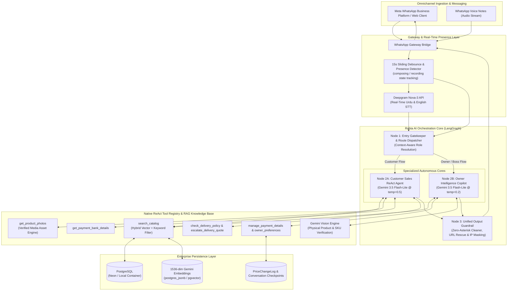

# 🌐 Rabta AI — Multimodal WhatsApp Native Agentic AI

> **Case Study & Technical Showcase:** This repository serves as the public architectural portfolio, technical specification, and system showcase for **Rabta AI**. The core production backend engine, proprietary prompts, and enterprise databases remain confidential and proprietary.

---

## Executive Summary

**Rabta AI** (رابطہ — meaning *"Connection"* in Urdu) is an enterprise-grade, multimodal WhatsApp-native autonomous dual-agent conversational platform engineered specifically for **local Pakistani merchants, retailers, distributors, and commercial businesses**. 

In Pakistan's high-velocity commerce landscape, over 90% of retail transactions and customer inquiries originate directly on WhatsApp via text, voice notes, and product photos. Rabta AI autonomously bridges this gap by acting as a 24/7 digital sales workforce: handling real-time catalog discovery, checking live warehouse stock, verifying products via computer vision, processing advance payments (Bank Transfer, JazzCash, EasyPaisa), and providing a dedicated copilot for business owners on WhatsApp.

---

## 🏗️ System Architecture & Dataflow

---

## 🧠 Core Engineering Pillars

### 1. LangGraph State Machine & Orchestration
- **Cyclic StateGraph Engine:** Engineered on **LangGraph** (`StateGraph`) with persistent checkpointing. Replaces fragile chain-of-custody pipelines with a deterministic 3-node graph:
  - **Node 1 (Gatekeeper):** Performs sender verification, role classification (Customer vs. Store Owner), and session state restoration.
  - **Node 2A & 2B (Dual Autonomous ReAct Agents):** Parallel, decoupled cognitive agents with isolated tools, memory states, and personas.
  - **Node 3 (Output Guardrail):** Enforces quality, formatting discipline, anti-flooding rules, and privacy protections before delivery.
- **Sliding 15-Second Debounce Window:** Integrates an asynchronous sliding timer with real-time WhatsApp presence updates (`composing` / `recording`). Eliminates fragmented, erratic responses by buffering multi-message customer thoughts into a unified reasoning context.

### 2. Native ReAct Agent Architecture (Reasoning + Acting)
- Powered by **Google Gemini 3.5 Flash-Lite** utilizing native ReAct tool/function calling loops:
  $$\text{Thought} \longrightarrow \text{Action (Tool Call)} \longrightarrow \text{Observation (SQL/API)} \longrightarrow \text{Final Response}$$
- Enables autonomous multi-step commercial reasoning: an inquiry like *"Is brand k konse models available hain aur unki pictures bhejo"* autonomously executes `search_catalog(query="Brand")`, evaluates available inventory, calls `get_product_photos(product_names=[...])`, and crafts a tailored response in a single execution turn.

### 3. Deterministic Tool & Function Calling Registry
- Uses strict **JSON Schema declarations** via the modern `google-genai` SDK:
  - `search_catalog`: Multi-attribute inventory discovery across category, specifications, manufacturer, brand, and budget limits.
  - `get_product_photos`: Fetches verified studio assets by product SKU or batch model queries.
  - `check_delivery_policy`: City-specific logistics validation and terms enforcement.
  - `escalate_delivery_quote`: Triggers shipping calculation once customer Name, City, and Address are collected.
  - `get_payment_bank_details`: Dispatches verified merchant accounts (Bank Transfer, JazzCash, EasyPaisa).
  - `recommend_alternative`: Discovers budget-friendly or in-stock alternatives when requested items are unavailable.

### 4. Hybrid Retrieval-Augmented Generation (RAG)
- **1536-Dimensional Vector Embeddings:** Generated via `gemini-embedding-002` (Matryoshka-truncated from 3072 dims for maximum vector search performance).
- **Hybrid Retrieval Strategy:** Combines high-speed SQL token matching with cosine similarity vector scoring in PostgreSQL (`postgres_jsonb` / `pgvector`). Customers can describe products conceptually (e.g., *"lightweight portable summer fabric"* or *"compact wireless fast charger"*) and receive precise catalog matches even when exact product names are omitted.

### 5. Multimodal Agentic AI & Gemini Vision
- **Physical SKU & Label Verification:** Retail products and packaged goods frequently share nearly identical visual appearances across model years or packaging variants. Gemini Vision cross-references customer photos and catalog imagery against physical barcodes, model numbers, packaging stamps, and specifications to eliminate visual confusion.
- **Multimodal Visual Search:** Customers can snap and send a photo of any item on WhatsApp to identify the product and immediately retrieve in-stock availability and confirmed pricing.

### 6. Voice Processing with Deepgram Nova-3
- **Bilingual Speech-to-Text Pipeline:** Deepgram Nova-3 API processes streaming audio bytes (OGG Opus) sent via WhatsApp voice notes.
- **Code-Switching Comprehension:** Natively handles fluid transitions between Urdu, English, and Roman Urdu speech, instantly transcribing spoken audio into structured text for downstream agentic reasoning.

### 7. Human-in-the-Loop (HITL) & Escalation Protocol
- **Intelligent Delegation Gating:** Routine catalog lookups, specs, and store hours/location queries are resolved 100% autonomously.
- **Escalation Triggers:** Automatically routes to the merchant's private WhatsApp copilot only when human judgment is mandatory:
  - Explicit customer price negotiations (*"gunjaish"* / discount requests).
  - Custom shipping calculations once Name, City, and Street Address are verified.
  - High-value B2B dealer inquiries, wholesale rates, and bulk orders.
- **Bilateral Decision Relay:** The business owner replies naturally to their copilot (*"dedo 10% discount"*), and Rabta AI automatically translates and relays the decision back to the customer.

### 8. Multi-Tier Guardrails & Safety Architecture
- **The Cardinal Grounding Law (Zero Hallucination):** The LLM possesses zero product specifications or pricing in its internal memory weights. All data quoted to customers must originate from verified database tool output.
- **Zero-Asterisk Output Formatting:** Guarantees that customer-bound messages are devoid of raw markdown asterisks (`*` or `**`), outputting clean, natural headings and lists.
- **IP Masking & URL Rescue:** Intercepts internal server addresses and converts them to public HTTPS CDN endpoints.
- **Anti-Flooding Controls:** Enforces a strict cap (max 4 images) per turn to prevent mobile WhatsApp session clutter.

### 9. Advanced Prompt Engineering Discipline
- **Hybrid Prompting Architecture:**
  - **Zero-Shot Task Constraints:** Strict negative prompting rules and JSON schema boundaries for NLU intent classification.
  - **Few-Shot Exemplars:** Contextual demonstrations of conversational Roman Urdu retail tone, sales closing questions, and good vs. bad message pairs.
- **Dynamic In-Context Injection (Part A / Part B):**
  - *Part A (Static System Prompt):* Permanent merchant profile, store policies, and behavioral instructions.
  - *Part B (Live Runtime Context):* Injects confirmed daily prices, in-stock SKUs, owner margin directives, and customer interaction history on every single turn.

---

## 🤖 The Dual Agents Explained

| Dimension | Customer Sales Agent (`customer_react_node`) | Owner Copilot Agent (`owner_react_node`) |
| :--- | :--- | :--- |
| **Persona** | Warm, respectful, commercially aggressive salesperson | Discrete, exceptionally capable executive assistant |
| **LLM Configuration** | **Gemini 3.5 Flash-Lite** (`temp=0.5`) | **Gemini 3.5 Flash-Lite** (`temp=0.2`) |
| **Primary Goal** | Drive sales, answer specs, book orders, collect advance | Execute owner commands, adjust inventory, confirm rates |
| **Input Style** | Conversational Roman Urdu & English | Casual owner shorthand (*"490k"*, *"sold out"*, *"push this"*) |
| **Special Policies** | Advance payment verification & delivery gating | Daily automated price confirmation workflows |
| **Output Style** | Crisp 1–3 short sentences, clean text, zero asterisks | Instant confirmation, short bullet points, actionable alerts |

---

## 🛠️ Complete Technology Stack

| Layer | Component | Badge | Description |
| :--- | :--- | :--- | :--- |
| **Agentic Framework** | **LangGraph** (`0.2.x`) |  | Stateful multi-turn conversation graph, routing & checkpoints |
| **Cognitive Engine** | **Google Gemini 3.5 Flash-Lite** |  | Core reasoning, ReAct function calling & sales intelligence |
| **Vision Verification** | **Gemini Vision Engine** |  | Physical barcode, packaging label & SKU image verification |
| **Voice STT Engine** | **Deepgram Nova-3** |  | Real-time audio streaming speech-to-text (Urdu/English) |
| **Vector Embeddings** | **Gemini Embedding 2** (`1536-dim`) |  | Multimodal and text semantic embeddings for catalog RAG |
| **Backend Framework** | **FastAPI** (Python 3.11+, AsyncIO) |  | High-throughput asynchronous backend server |
| **Data Validation** | **Pydantic** (`v2.x`) |  | Strict runtime data contracts, schema coercion & JSON formatting |
| **Database & ORM** | **PostgreSQL** + **SQLAlchemy Asyncpg** |  | Multi-tenant persistent store, audit history, session state |
| **In-Memory Cache** | **Redis** |  | High-speed cache for session locks & transient presence states |
| **Messaging Channel** | **Meta WhatsApp Cloud Platform** |  | Official WhatsApp Business API & bidirectional gateway |
| **Reverse Proxy & SSL**| **Caddy** |  | Automated TLS/SSL termination, WebSocket & HTTP reverse proxy |
| **Containerization** | **Docker** & **Docker Compose** |  | Production container packaging and microservices |

---

## 📈 Commercial Metrics & Impact

- **Live Retail Catalog:** Hundreds of distinct commercial SKUs, verified product imagery, and daily dynamic price confirmations.
- **Automated Regression Suite:** 28 end-to-end integration and behavior scenarios tested and passing with zero regressions.
- **Latency Performance:** Sub-1.5s end-to-end ReAct tool resolution and response generation on live WhatsApp channels.
- **Bilingual Accuracy:** 100% resolution of Roman Urdu colloquial retail expressions and phonetic variations without hallucination.

---

## 📄 License & Intellectual Property

Copyright © 2026 **ZeroPointIntel / Rabta AI Engineering Team**. All rights reserved.  
This software, prompt engineering architecture, database schemas, and associated algorithms are **proprietary and confidential**. Unauthorized reproduction, reverse-engineering, commercial deployment, or redistribution is strictly prohibited.
