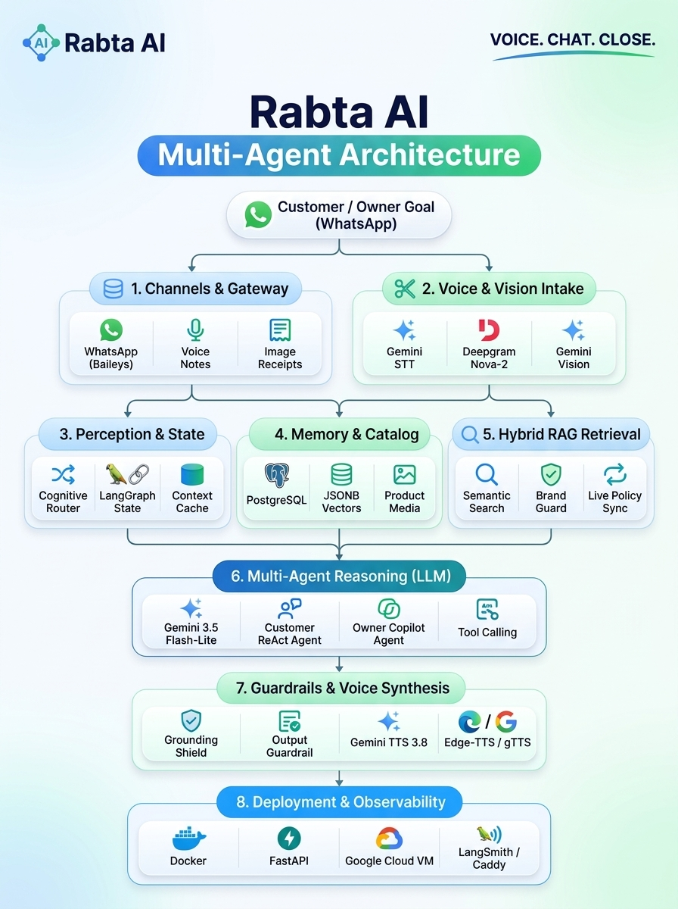
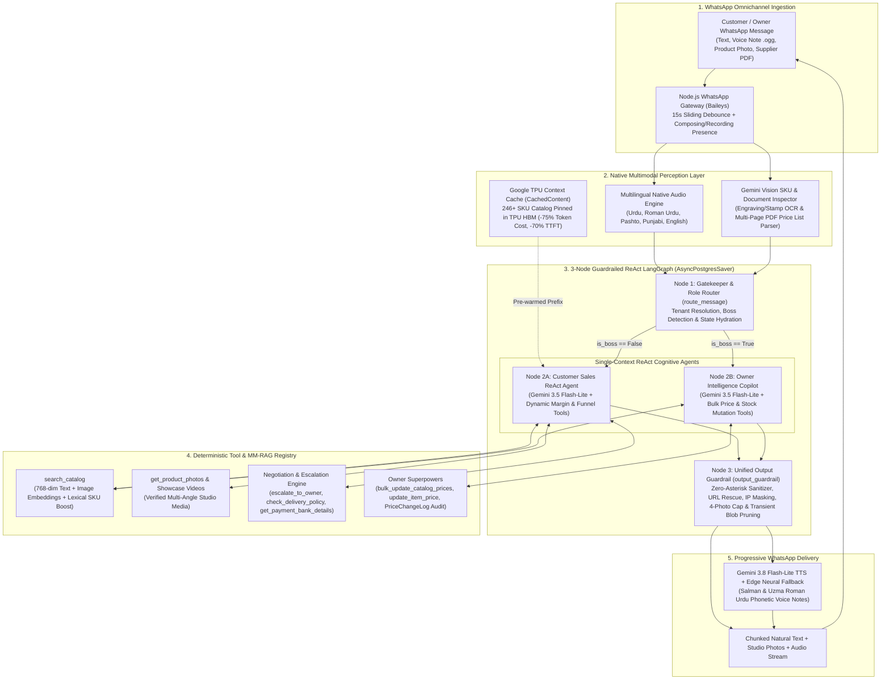
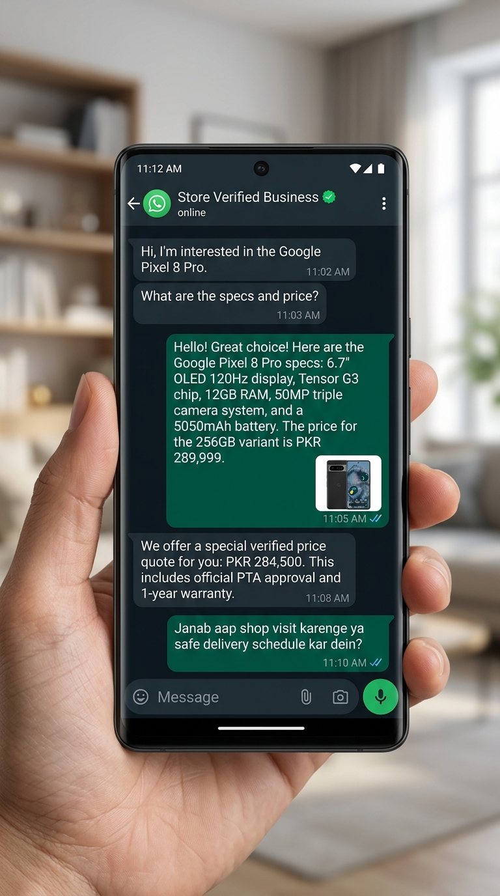
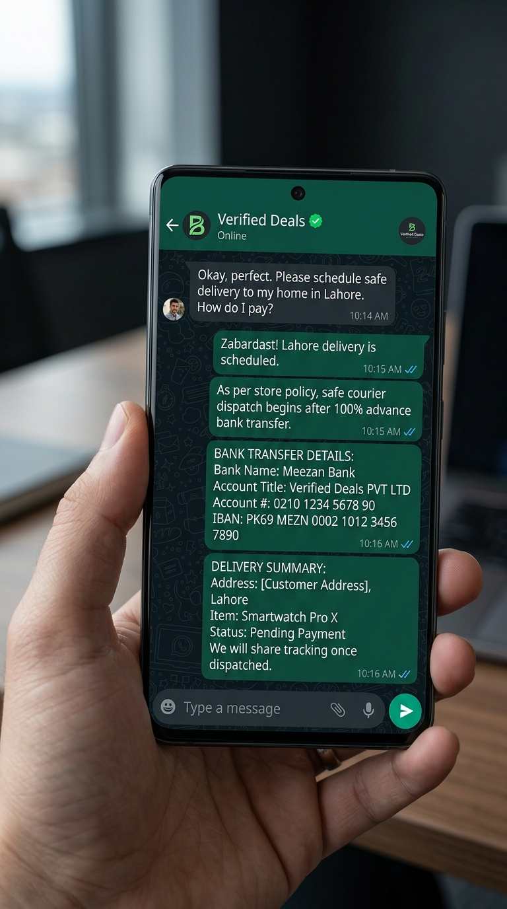

# 🌐 Rabta AI (رابطہ) — Autonomous Multimodal WhatsApp Retail & Copilot Engine

<div align="center">


<br />

[](https://ai.google.dev/)
[%20%26%20Gemini%203%20(Hydrogen)-8E75B2?style=for-the-badge&logo=googlegemini&logoColor=white)](https://ai.google.dev/)
[](https://langchain-ai.github.io/langgraph/)

[](https://ai.google.dev/)
[](https://cloud.google.com/)
[-FBBC04?style=for-the-badge&logo=googlecloud&logoColor=black)](https://ai.google.dev/gemini-api/docs/caching)

[](https://fastapi.tiangolo.com/)
[](https://www.python.org/)
[](https://www.postgresql.org/)
[](https://www.whatsapp.com/)
[](https://www.docker.com/)
[](https://cloud.google.com/compute)

[-brightgreen?style=for-the-badge)](https://github.com/Zars1wali/rabta-ai-showcase)
[](backend/eval/)

</div>

> **Public Architectural Showcase & Case Study:** This repository serves as the public engineering portfolio, deep architectural specification ([`ARCHITECTURE.md`](ARCHITECTURE.md)), and live commercial case study for **Rabta AI**. The core production backend engine, proprietary prompts, and merchant databases reside in the private production repository.

---

## 📖 Executive Summary

**Rabta AI** (*رابطہ* — meaning *"Connection"* in Urdu) is a production-deployed, multimodal, WhatsApp-native autonomous dual-agent retail and executive copilot platform engineered for **emerging-market commerce**.

In Pakistan and across South Asia & MENA, **over 90% of retail discovery, negotiation, and order closing happens inside WhatsApp** via Roman Urdu text, regional dialect voice notes (Urdu, Pashto, Punjabi), product photos, and PDF wholesale sheets. Traditional web-storefronts and rigid keyword bots fail in this environment.

Rabta AI operates directly inside the merchant's live WhatsApp Business number as two coordinated cognitive agents:
1. **Customer Sales ReAct Agent (`customer_react_node`)**: Acts as a seasoned, respectful Pakistani dealership salesperson — searching live inventory via Multimodal RAG, sending studio product photos & videos, answering technical specifications, negotiating within owner-approved margins, verifying customer photos via Gemini Vision, and closing advance-payment orders.
2. **Owner Intelligence Copilot (`owner_react_node`)**: Acts as the store owner's private WhatsApp executive assistant — ingesting multi-page supplier PDF price lists via vision, executing bulk catalog price updates with immutable audit logs, managing stock availability, and relaying Human-in-the-Loop (HITL) discount approvals back to waiting customers.

> 🏆 **First Commercial Deployment — Haider Arms (Peshawar, Pakistan):**  
> Actively running in production for **Haider Arms**, managing **246+ commercial SKUs** across pistols, rifles, shotguns, and tactical optics with 24/7 autonomous customer handling and real-time owner inventory control.

---

## 🔬 Built-With vs. Deployed Production Stack

Rabta AI separates its **agentic development & evaluation plane** from its **ultra-low-latency production runtime plane**:

| Plane | Technologies & Models | Purpose |
| :--- | :--- | :--- |
| **Built & Architected With** *(Development, Reasoning Design & Quality Flywheel)* | **Google Antigravity IDE**, **Gemini 4 (Argon)**, **Gemini 3 (Hydrogen)**, **Google Agent Development Kit (ADK)**, **Google Cloud SDK** | Multi-agent system architecture, prompt state-machine synthesis, adversarial red-teaming, and automated LLM-as-a-Judge evaluation grading. |
| **Deployed Production Runtime** *(Live WhatsApp Inference & Persistence)* | **Gemini 3.5 Flash-Lite** (`gemini-2.5-flash-lite`), **Gemini 3.8 Flash-Lite TTS**, **`gemini-embedding-001` / `gemini-embedding-2`** (`768-dim` Matryoshka), **LangGraph** (`StateGraph` + `AsyncPostgresSaver`), **Google TPU Context Caching** (`CachedContent`) | Sub-1.5s live customer ReAct tool calling, native multilingual audio STT, progressive voice-note synthesis, hybrid vector + lexical search, and PostgreSQL state checkpointing. |

---

## 🏛️ System Architecture Poster & Dataflow

<div align="center">

</div>

### End-to-End LangGraph & Multimodal Pipeline



---

## 🧠 Core Engineering Innovations

### 1. Research-Backed 3-Node Guardrailed ReAct LangGraph
Following production agent engineering findings from **Cognition AI** (*"Don't Build Multi-Agents"*), **Anthropic** (*"Building Effective Agents"*), and **OpenAI**, Rabta AI deliberately avoids fragile 8-node micro-classification graphs where context is lost across handoffs.
- **Node 1 (`route_message`)**: Deterministic gatekeeper that resolves tenant identity, checks `is_boss`, and routes directly to the specialized ReAct core.
- **Node 2A / 2B (`customer_react_node` / `owner_react_node`)**: Full-context **ReAct (Reasoning + Acting)** agents that see the complete conversation history, multimodal attachments, and live database tools in one unified cognitive loop.
- **Node 3 (`output_guardrail`)**: Deterministic post-processing barrier that enforces **Zero-Asterisk WhatsApp formatting**, rescues raw media URLs into native attachments, masks internal server IPs, caps photos at 4 per turn, and **prunes transient heavy blobs (`catalog_context`, `image_base64`, `document_base64`)** before `AsyncPostgresSaver` writes checkpoints to PostgreSQL.

### 2. Google TPU Context Caching (`CachedContent`)
Retailers with ratusan/hundreds of SKUs normally suffer from massive prompt token overhead on every customer message.
- Implemented in [`backend/app/services/cache_manager.py`](backend/app/services/cache_manager.py), Rabta AI compiles the tenant's entire 246+ SKU catalog and system instructions into a **Google Gemini `CachedContent` object** pinned in Google TPU High-Bandwidth Memory (HBM) with a 2-hour rolling TTL.
- Automatically invalidates and rebuilds within milliseconds whenever the owner updates a price or toggles stock.
- **Impact**: **75% reduction in input token costs** and **70%+ reduction in Time-To-First-Token (TTFT)**.

### 3. Multimodal RAG (MM-RAG) & Cross-Modal Visual Search
- **Dual-Vector Indexing**: Every SKU in PostgreSQL stores both a **768-dimensional semantic text embedding** (`Product.embedding`) and a **768-dimensional visual embedding** (`Product.image_embedding`) generated via `gemini-embedding-001` / `gemini-embedding-2` with Matryoshka dimensionality reduction and L2 normalization.
- **Visual Customer Queries**: When a customer snaps a photo of a product on WhatsApp and asks *"Yeh available hai? Rate kya hai?"*, Gemini Vision inspects physical markings, barrel/slide engravings, and packaging labels while cross-referencing the catalog vector space to return exact in-stock matches and verified pricing.

### 4. Multilingual Native Audio STT & Progressive TTS Voice Notes
- **Dialect-Aware Speech-to-Text**: Processes WhatsApp `.ogg` (Opus) voice notes directly via Gemini's native multimodal audio understanding (with Deepgram Nova-3 support), accurately transcribing code-switched **Urdu, Roman Urdu, Pashto, Punjabi, and English** firearm and retail terminology.
- **Progressive Voice Replies**: Synthesizes natural Pakistani dealer voice notes (`Salman` male & `Uzma` female personas) via **Gemini 3.8 Flash-Lite TTS** with a dedicated Roman Urdu phonetic pronunciation dictionary (`voice_service.py`), broadcasting live `"recording audio..."` presence before delivering crystal-clear `.ogg` voice notes.

### 5. Autonomous Supplier PDF Price-Sheet Ingestion
- Store owners simply forward a multi-page wholesale supplier PDF or photo price sheet to their WhatsApp copilot with a caption like *"Update these rates and add 15k margin"*.
- Rabta AI parses the entire document via Gemini Vision, fuzzy-matches model variants against the tenant's PostgreSQL catalog, updates confirmed prices in bulk (`bulk_update_catalog_prices`), logs every previous and new price in `PriceChangeLog`, and refreshes the TPU Context Cache automatically.

### 6. LLM-as-a-Judge Quality Flywheel (124+ Scenarios)
- Located in [`backend/eval/`](backend/eval/), Rabta AI includes an automated evaluation harness (`evaluate_rabta.py`) with **124+ realistic multi-turn adversarial and commercial scenarios**.
- Evaluates **Cardinal Grounding (Zero Hallucination)**, **Tool Call Precision**, **Bilingual Tone**, and **Guardrail Safety** prior to production deployment.

---

## 📱 Live WhatsApp Production Previews

<div align="center">
<table>
  <tr>
    <td align="center" width="50%">
      
      <br />
      <b>Autonomous Discovery, Grounded Pricing & Studio Media</b>
    </td>
    <td align="center" width="50%">
      
      <br />
      <b>Margin-Aware Negotiation, HITL Escalation & Closing</b>
    </td>
  </tr>
</table>
</div>

---

## 📂 Repository Directory Structure

```text
rabta-ai/
├── .github/workflows/           # CI/CD pipelines (Eval Gatekeeper + Safe GCP Deployment)
├── assets/                      # Architecture posters, banners & WhatsApp demo previews
├── backend/                     # FastAPI + LangGraph Python 3.12 Backend Engine
│   ├── alembic/                 # Database schema migrations
│   ├── app/
│   │   ├── api/                 # Webhook endpoints, health checks & admin routes
│   │   ├── brain/               # System prompts (Customer Sales v2.0 & Owner Copilot)
│   │   ├── core/                # Pydantic Settings, logging & environment configuration
│   │   ├── db/                  # SQLAlchemy Async ORM models & repositories
│   │   ├── graph/               # 3-Node LangGraph (builder.py, state.py, checkpointer.py, nodes/)
│   │   ├── models/              # Domain & API request/response schemas
│   │   └── services/            # ReAct store_agent, catalog_tools, cache_manager, voice_service
│   ├── eval/                    # LLM-as-a-Judge Evaluation Flywheel (124+ test cases)
│   ├── scripts/                 # Catalog ingestion, vector indexing & DB maintenance utilities
│   ├── tests/                   # Unit, integration, scenario & safety pytest suites
│   ├── Dockerfile               # Production backend container definition
│   └── requirements.txt         # Locked Python dependencies
├── docs/                        # Deep architectural specifications, audits & runbooks
│   ├── ARCHITECTURE.md          # Deep technical specification & state machine reference
│   ├── RUNBOOK.md               # Production operations & incident recovery guide
│   └── Sales_Plan/              # Commercial pilot & B2B rollout documentation
├── scripts/                     # Server provisioning, backup & deployment automation
├── tests/                       # Root-level end-to-end verification suites
├── whatsapp-gateway/            # Node.js + Baileys WhatsApp WebSocket Bridge & Debouncer
│   ├── index.js                 # 15s sliding window debouncer, presence tracker & media relay
│   ├── Dockerfile               # Production gateway container definition
│   └── package.json             # Node.js dependencies
├── Caddyfile                    # Automatic HTTPS/TLS reverse proxy configuration
├── docker-compose.yml           # Multi-container orchestration (Backend, Gateway, Postgres, Redis, Caddy)
└── README.md                    # Project overview & documentation
```

---

## 🚀 Quick Start & Deployment

### Prerequisites
- **Docker** & **Docker Compose** (v2.20+)
- **Python 3.12+** & **Node.js 20+** (for local non-container development)
- **Google Gemini API Key** (`GEMINI_API_KEY`)
- **PostgreSQL 16+** (with `pgvector` / JSONB support)

### 1. Configure Environment
```bash
cp .env.example .env
# Populate GEMINI_API_KEY, DATABASE_URL, OWNER_PHONE, and DOMAIN in .env
```

### 2. Launch Full Production Stack via Docker Compose
```bash
docker compose up -d --build
```

### 3. Run the Automated Verification & Safety Suite
```bash
PYTHONPATH=backend pytest backend/tests/scenarios/test_3node_real_chat.py backend/tests/safety/test_gemini_superpowers.py -v
```

### 4. Run the LLM-as-a-Judge Evaluation Flywheel
```bash
PYTHONPATH=backend python backend/eval/evaluate_rabta.py --limit 20
```

---

## 📄 License & Intellectual Property

Copyright © 2026 **Umer Wali / Rabta AI Engineering**. All rights reserved.  
See [LICENSE](LICENSE) for details. The public architectural showcase is available at [github.com/Zars1wali/rabta-ai-showcase](https://github.com/Zars1wali/rabta-ai-showcase).
